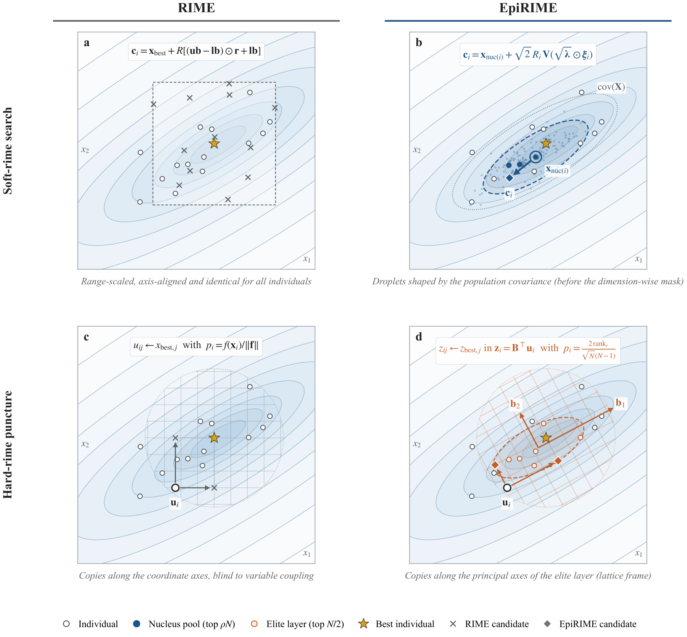
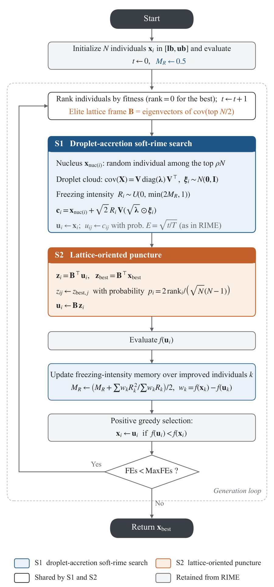
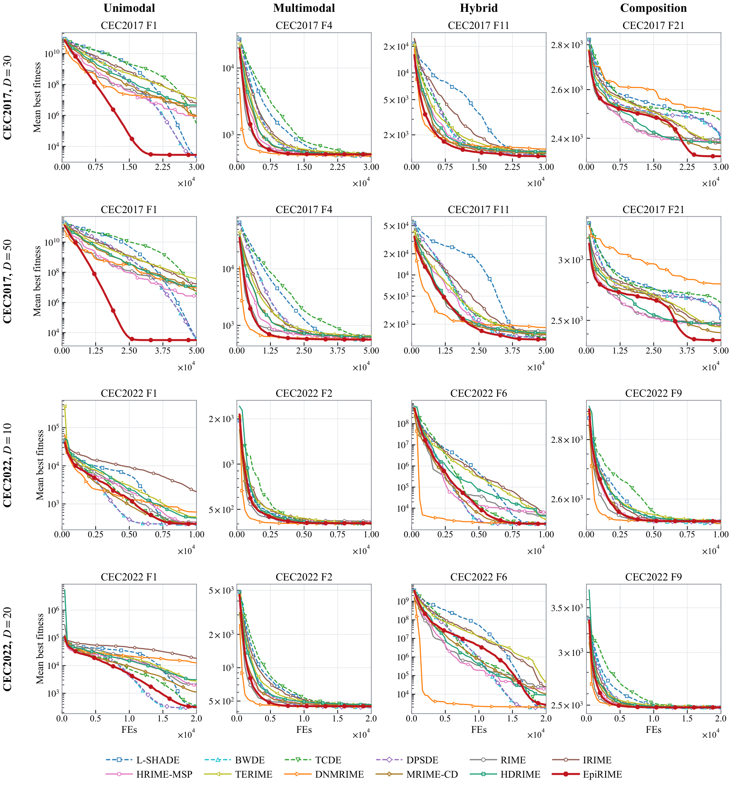
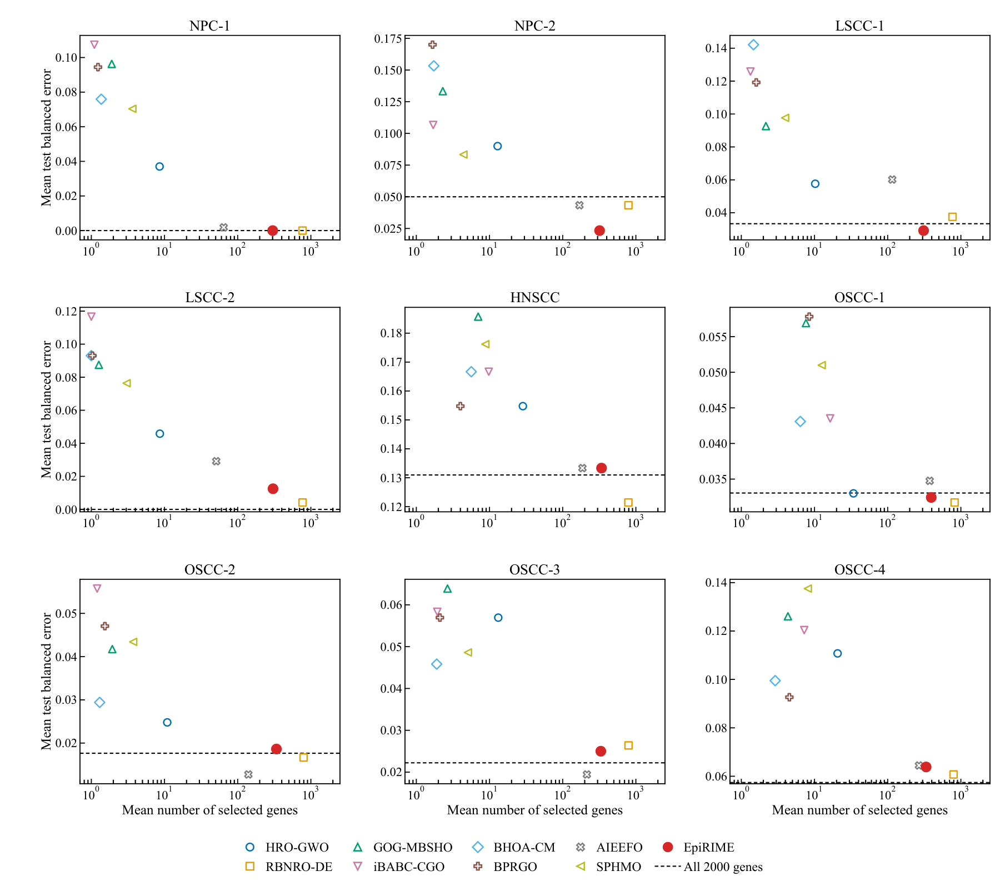

<div align="center">

# EpiRIME: Epitaxial RIME Algorithm

**A covariance-guided improvement of the RIME optimizer with a rotation-invariant puncture, applied to wrapper gene
selection on cancer expression data**

[](https://www.python.org/)
[](https://numpy.org/)
[](LICENSE)
[](#benchmark-functions)

[Overview](#overview) •
[Installation](#installation) •
[Quick start](#quick-start) •
[Results](#results) •
[Reproducing the experiments](#reproducing-the-experiments) •
[Data](#data) •
[License](#license)

</div>

---

## Overview

EpiRIME is an improved version of the RIME optimizer [1], a physics-based metaheuristic that models the growth of
rime ice. It keeps the population structure, the dimension-wise soft-rime mask, and the positive greedy selection of
RIME, and replaces its two search operators by two strategies inspired by epitaxial crystal growth, in which a new
layer grows on a substrate and takes over its lattice orientation:

<p align="center">
  
</p>
<p align="center"><sub><b>RIME (left) and EpiRIME (right) on a two-dimensional rotated ill-conditioned function.</b>
(a) RIME draws soft-rime candidates in a range-scaled box around the best individual; (b) S1 attaches droplets
shaped by the population covariance to nuclei drawn from the best individuals; (c) the RIME puncture copies
coordinates of the best individual along the original axes; (d) S2 copies them along the principal axes of the elite
individuals.</sub></p>

* **S1, droplet-accretion soft-rime search.** Every individual attaches a droplet to a *nucleus* drawn at random from
  the best individuals. The droplet is shaped by the covariance of the whole population and scaled by an individual
  *freezing intensity*, which is adapted from the successful steps of earlier generations. The step size shrinks as
  the population converges and follows its principal directions.
* **S2, lattice-oriented puncture.** The puncture copies coordinates of the best individual in the coordinate
  system given by the principal axes of the elite individuals (the *lattice frame*), with a probability that depends
  on the fitness rank. The puncture operator is invariant to rotations of the search space and to strictly
  increasing transformations of the objective.

EpiRIME adds a single parameter to RIME, the nucleus-pool ratio `rho` (default 0.3). The update equations are given
in the docstring of [`epirime/optimizer.py`](epirime/optimizer.py).

<details>
<summary><b>Flowchart of EpiRIME</b> (click to expand)</summary>
<p align="center">
  
</p>
<p align="center"><sub>Blue: S1; orange: S2; gray: retained from RIME.</sub></p>
</details>

### Highlights

* **Best Friedman rank among twelve algorithms on CEC2017** with D = 30 and D = 50, against four state-of-the-art
  differential evolution (DE) variants, the original RIME, and six RIME variants published from 2024 to 2026.
* **Both strategies contribute:** in the ablation analysis, EpiRIME ranks first in all four benchmark settings,
  followed by RIME with S1 only.
* **One parameter, low overhead:** on the benchmark functions (D ≤ 50), a run takes 1.3 to 1.5 times the CPU time of
  RIME, about the same as the DE algorithms.
* **Gene selection on nine head and neck cancer cohorts** with patient-level data splits: second-best Friedman rank
  on the test error of held-out patients among nine algorithms, keeping 15% to 20% of the 2000 genes with a test
  error close to that of the full gene set.

## Installation

Python 3.8 or later with NumPy is required; matplotlib is needed only to draw the figures.

```bash
git clone https://github.com/Vivian-Wang2020/EpiRIME.git
cd EpiRIME
pip install -r requirements.txt
```

The code is not installed as a package: run the scripts from the repository folder, or add the folder to
`PYTHONPATH` to import `epirime` from elsewhere.

## Quick start

EpiRIME minimizes a *vectorized* objective function that maps an array of shape `(n, D)` (one candidate solution
per row) to an array of `n` objective values. The bounds are scalars or arrays of length `D`.

```python
import numpy as np
from epirime import EpiRIME

def sphere(X):
    return np.sum(X ** 2, axis=1)

opt = EpiRIME(pop_size=100, max_fes=20_000, seed=1)
res = opt.optimize(sphere, -100, 100, 20)         # objective, lb, ub, D
print(res.best_fit)                                # best objective value
print(res.best_x)                                  # best solution
```

| Argument   | Default | Meaning                                                                        |
|------------|---------|--------------------------------------------------------------------------------|
| `pop_size` | 100     | population size N                                                              |
| `max_fes`  | 300000  | budget of objective function evaluations; the run stops when it is used up     |
| `seed`     | None    | seed of NumPy's random generator                                               |
| `rho`      | 0.3     | nucleus-pool ratio: the nucleus pool holds the best round(rho N) individuals   |

`optimize` returns a `Result` with the fields `best_fit`, `best_x`, `fes` (number of evaluations used), and the
convergence record `curve_fes` / `curve_fit` (best objective value after each batch of evaluations).

Each generation performs two eigen-decompositions of D x D covariance matrices, so the cost per generation grows as
O(D^3). For D up to a few hundred this is negligible compared with most objective functions; for D = 2000 (gene
selection), a run of 20,000 evaluations takes about 13 minutes on one CPU core.

### Benchmark functions

```python
from epirime.cec import get

f = get(2017, 5, 30)          # suite, function number, dimension
values = f(X)                 # X of shape (n, 30)
f.lb, f.ub, f.optimum         # bounds and optimal value
```

The functions reproduce the official C implementations of the CEC2017 [2] and CEC2022 [3] competitions on
bound-constrained single-objective optimization, including their known particularities (listed in the docstring of
[`epirime/cec.py`](epirime/cec.py)). CEC2017 F2 was removed from the suite by the organizers and is not used. Only
the data for the dimensions used here are included (CEC2017: D = 30, 50; CEC2022: D = 10, 20).

## Results

All numbers below are from the paper; the raw results are in `EpiRIME-results.zip` (see
[Results package and figures](#results-package-and-figures)).

### CEC2017 and CEC2022 benchmarks

Friedman mean rank over all functions of each setting (lower is better; position in parentheses). Budget 1000 D
function evaluations, 30 runs per function.

| Algorithm     | CEC2017, D = 30 | CEC2017, D = 50 | CEC2022, D = 10 | CEC2022, D = 20 |
|---------------|-----------------|-----------------|-----------------|-----------------|
| L-SHADE       | 5.62 (4)        | 5.76 (4)        | 3.75 (4)        | 4.00 (4)        |
| BWDE          | 3.90 (2)        | 4.41 (2)        | 3.25 (2)        | 3.75 (3)        |
| TCDE          | 6.97 (6)        | 6.66 (7)        | 6.42 (5)        | 6.58 (6)        |
| DPSDE         | 4.00 (3)        | 4.79 (3)        | **3.08 (1)**    | **3.25 (1)**    |
| RIME          | 9.86 (12)       | 9.62 (12)       | 9.33 (12)       | 9.67 (12)       |
| IRIME         | 7.59 (8)        | 6.62 (6)        | 8.08 (9)        | 6.92 (7)        |
| HRIME-MSP     | 7.90 (9)        | 7.34 (9)        | 8.92 (10)       | 8.08 (9)        |
| TERIME        | 7.34 (7)        | 7.31 (8)        | 7.92 (8)        | 7.83 (8)        |
| DNMRIME       | 8.79 (11)       | 9.17 (11)       | 9.25 (11)       | 9.50 (11)       |
| MRIME-CD      | 5.76 (5)        | 5.93 (5)        | 6.75 (6)        | 6.08 (5)        |
| HDRIME        | 7.93 (10)       | 7.79 (10)       | 7.75 (7)        | 8.83 (10)       |
| **EpiRIME**   | **2.34 (1)**    | **2.59 (1)**    | 3.50 (3)        | 3.50 (2)        |

<p align="center">
  
</p>
<p align="center"><sub><b>Convergence of the twelve algorithms</b> on the first function of each function class
(mean best-so-far objective value over 30 runs, logarithmic scale). EpiRIME is the thick red line. The curves of all
functions are in the supplementary material of the paper.</sub></p>

### Gene selection in head and neck cancer

Wrapper gene selection on nine public expression datasets (2000 genes each), compared with eight metaheuristics
proposed for cancer gene selection from 2024 to 2026. Friedman mean rank over the nine datasets (position in
parentheses) and mean balanced error over the nine datasets.

| Algorithm   | Test error rank | Number of genes rank | Training balanced error | Test balanced error |
|-------------|-----------------|----------------------|-------------------------|---------------------|
| HRO-GWO     | 4.44 (4)        | 6.00 (6)             | 0.004                   | 0.068               |
| RBNRO-DE    | **1.67 (1)**    | 9.00 (9)             | 0.019                   | 0.038               |
| GOG-MBSHO   | 7.33 (8)        | 3.44 (4)             | 0.003                   | 0.098               |
| iBABC-CGO   | 7.61 (9)        | 2.50 (3)             | 0.003                   | 0.100               |
| BHOA-CM     | 6.22 (5)        | **1.83 (1)**         | 0.002                   | 0.094               |
| BPRGO       | 6.94 (7)        | 2.44 (2)             | 0.002                   | 0.098               |
| AIEEFO      | 2.67 (3)        | 7.00 (7)             | 0.014                   | 0.044               |
| SPHMO       | 6.22 (5)        | 4.78 (5)             | 0.004                   | 0.087               |
| **EpiRIME** | 1.89 (2)        | 8.00 (8)             | 0.016                   | 0.038               |

<p align="center">
  
</p>
<p align="center"><sub><b>Mean number of selected genes and mean test balanced error</b> over 30 runs on each
dataset. EpiRIME is the red filled circle; the dashed line is the test error of the classifier with all 2000
genes.</sub></p>

The algorithms that minimized the training fitness best selected one to three genes on most datasets and generalized
worse to the held-out patients: on small expression cohorts, the training fitness alone is not a reliable criterion
for comparing gene selection algorithms.

## Reproducing the experiments

### Benchmark experiments

Settings: budget 1000 D function evaluations, population size 100, `rho = 0.3`, 30 independent runs per function;
CEC2017 F1 and F3 to F30 with D = 30 and 50, CEC2022 F1 to F12 with D = 10 and 20.

```bash
python run_cec.py --suite 2017 --dim 30 --jobs 8 --out cec2017_d30.json
python run_cec.py --suite 2017 --dim 50 --jobs 8 --out cec2017_d50.json
python run_cec.py --suite 2022 --dim 10 --jobs 8 --out cec2022_d10.json
python run_cec.py --suite 2022 --dim 20 --jobs 8 --out cec2022_d20.json
```

| Option    | Default     | Meaning                                                   |
|-----------|-------------|-----------------------------------------------------------|
| `--suite` | (required)  | 2017 or 2022                                              |
| `--dim`   | (required)  | 30 or 50 for CEC2017, 10 or 20 for CEC2022                |
| `--funcs` | whole suite | function numbers, e.g. `--funcs 1 6 11`                   |
| `--runs`  | 30          | number of runs per function                               |
| `--rho`   | 0.3         | nucleus-pool ratio (the sensitivity analysis varies it)   |
| `--jobs`  | 1           | number of worker processes                                |
| `--out`   | none        | JSON file for the results                                 |

The script prints the mean and standard deviation of the best objective value of every function. The JSON file
holds `fitness[function][run]` (best objective value; the optimum is not subtracted) and `curves[function][run]`
(best objective value at 50 equally spaced points of the budget). One run takes about 0.5 s (CEC2017, D = 30) to
1.4 s (D = 50) on one CPU core.

### Gene selection experiments

Each dataset is a binary classification task, tumor against non-malignant tissue, restricted to the 2000 probes with
the largest variance. A candidate solution `x` in `[0, 1]^2000` selects gene `j` when `x_j > 0.5`, and the fitness
to be minimized is

```
F(x) = 0.99 BE(S) + 0.01 |S| / 2000,
```

where `BE(S)` is the leave-one-patient-out balanced error of a k-nearest-neighbor classifier (k = 3) on the training
samples and `|S|` is the number of selected genes. In each run, the patients are split into 70% training and 30% test
data, stratified by class, so that all samples of one patient fall on the same side. After the search, the selected
genes are evaluated by the balanced error on the held-out test patients.

Settings: budget 20,000 fitness evaluations, population size 100, `rho = 0.3`, 30 runs per dataset.

```bash
python run_gene_selection.py --jobs 8 --out gene_selection.json          # all datasets, 30 runs each
python run_gene_selection.py --datasets NPC-GSE53819 --runs 3            # a short test
```

| Option       | Default      | Meaning                                    |
|--------------|--------------|--------------------------------------------|
| `--datasets` | all nine     | dataset names (see [Data](#data))          |
| `--runs`     | 30           | number of runs per dataset                 |
| `--fes`      | 20000        | budget of fitness evaluations              |
| `--rho`      | 0.3          | nucleus-pool ratio                         |
| `--jobs`     | 1            | number of worker processes                 |
| `--out`      | none         | JSON file for the results                  |

The script prints, for every dataset, the mean training fitness, number of selected genes, training balanced error,
and test balanced error. The JSON file lists every run with these values and the probe identifiers of the selected
genes. All 270 runs take about 60 CPU hours.

The problem can also be used directly:

```python
from epirime import EpiRIME
from epirime.gene_selection import GeneSelection

p = GeneSelection("NPC-GSE53819", run=0)          # dataset and run (the run fixes the data split)
res = EpiRIME(pop_size=100, max_fes=20_000, seed=1).optimize(p.f, p.lb, p.ub, p.dim)
m = p.mask(res.best_x)                            # boolean mask of the selected genes
print(m.sum(), p.train_error(m), p.test_error(res.best_x), p.probes[m])
```

### Seeds

All scripts use the seeds of the paper, so the runs are paired across algorithms:

* benchmark functions: run r on function F uses the seed 2026 + 7 F + 20 r;
* gene selection: run r on dataset number k (order of `DATASETS` in `epirime/gene_selection.py`, starting at 0) uses
  the data split seed 7,000,000 + 1000 k + r and the optimizer seed 8,000,000 + 1000 k + r.

The results of the paper were obtained with NumPy 2.4. Other NumPy versions or linear algebra libraries can change
the results in the last digits.

### Results package and figures

The raw results of all experiments are in [`EpiRIME-results.zip`](EpiRIME-results.zip) in the root of this
repository. For the benchmark experiments (twelve algorithms), the ablation analysis, the sensitivity analysis, and
the gene selection experiments (nine algorithms), it contains the result of every run, the convergence records, the
CPU times, and the selected genes; its README describes the file formats. All tables and figures of the paper and its
supplementary material can be computed from these files.

The result figures of the paper (Figures 3 to 9) and of its supplementary material (Figures S1 to S24) are drawn with

```bash
unzip EpiRIME-results.zip
python scripts/plot_results.py --results EpiRIME-results --out figures
```

which writes every figure as PDF and PNG (`--only main`, `--only supplementary`, or `--only gene_selection` draws a
part of them). The list of figures is given at the top of [`scripts/plot_results.py`](scripts/plot_results.py).

## Data

The gene expression data are public series of the Gene Expression Omnibus (GEO). `data/geo/` holds the processed
datasets: log2 expression values of the 2000 probes with the largest variance (a label-free filter), the class
labels, the patient identifiers used for the patient-level split, the probe identifiers and gene symbols, and the GSM
accessions of the samples.

| Name            | Site                          | GEO series | Platform | Samples (tumor/normal) | Patients |
|-----------------|-------------------------------|------------|----------|------------------------|----------|
| NPC-GSE12452    | nasopharynx                   | GSE12452   | GPL570   | 41 (31/10)             | 41       |
| NPC-GSE53819    | nasopharynx                   | GSE53819   | GPL6480  | 36 (18/18)             | 18       |
| LSCC-GSE59102   | larynx                        | GSE59102   | GPL6480  | 42 (29/13)             | 31       |
| LSCC-GSE143224  | larynx                        | GSE143224  | GPL5175  | 25 (14/11)             | 14       |
| HNSCC-GSE107591 | oral cavity, larynx, pharynx  | GSE107591  | GPL6244  | 47 (24/23)             | 24       |
| OSCC-GSE30784   | oral cavity                   | GSE30784   | GPL570   | 212 (167/45)           | 212      |
| OSCC-GSE25099   | oral cavity                   | GSE25099   | GPL5175  | 79 (57/22)             | 79       |
| OSCC-GSE37991   | oral cavity                   | GSE37991   | GPL6883  | 80 (40/40)             | 40       |
| OSCC-GSE13601   | oral tongue                   | GSE13601   | GPL8300  | 57 (31/26)             | 37       |

NPC: nasopharyngeal carcinoma; LSCC: laryngeal squamous cell carcinoma; HNSCC: head and neck squamous cell carcinoma;
OSCC: oral squamous cell carcinoma. `data/geo/datasets.json` records how the patients were identified in each
series.

To rebuild `data/geo/` from the original files, download the series matrix files (`<GSE>_series_matrix.txt.gz`) from
GEO into a folder, optionally with the platform annotations (`gpl/<GPL>.annot.gz`, used only for the gene symbols),
and run

```bash
python scripts/prepare_geo.py --raw path/to/folder
```

The benchmark data in `epirime/cec_data/` are the official data files of the CEC2017 and CEC2022 competitions.

## Repository structure

```
EpiRIME/
├── epirime/
│   ├── optimizer.py          EpiRIME
│   ├── cec.py                CEC2017 and CEC2022 benchmark functions (NumPy port of the official C code)
│   ├── cec_data/             official shift, rotation, and shuffle data
│   └── gene_selection.py     gene selection problem: fitness, patient-level split, test error
├── data/geo/                 the nine processed gene expression datasets (.npz) and datasets.json
├── scripts/
│   ├── prepare_geo.py        rebuilds data/geo/ from the GEO series matrix files
│   └── plot_results.py       draws the result figures from the results package
├── assets/                   images of this README
├── run_cec.py                benchmark experiments
├── run_gene_selection.py     gene selection experiments
├── EpiRIME-results.zip       raw results of all experiments
├── requirements.txt
└── LICENSE
```

## Citation

The reference of the paper will be added here after publication.

## License

The code is released under the [MIT License](LICENSE). The gene expression data are derived from public GEO series
and the benchmark data from the CEC competitions; please cite the original sources when you use them.

## References

[1] H. Su, D. Zhao, A. A. Heidari, L. Liu, X. Zhang, M. Mafarja, H. Chen. RIME: A physics-based optimization.
Neurocomputing 532 (2023) 183-214. https://doi.org/10.1016/j.neucom.2023.02.010

[2] N. H. Awad, M. Z. Ali, J. J. Liang, B. Y. Qu, P. N. Suganthan. Problem definitions and evaluation criteria for
the CEC 2017 special session and competition on single objective bound constrained real-parameter numerical
optimization. Technical report, Nanyang Technological University, Singapore, 2016.

[3] A. Kumar, K. V. Price, A. W. Mohamed, A. A. Hadi, P. N. Suganthan. Problem definitions and evaluation criteria
for the CEC 2022 special session and competition on single objective bound constrained numerical optimization.
Technical report, Nanyang Technological University, Singapore, 2021.
